# 2. Instalación

En este tema se monta el entorno de trabajo para las prácticas:

- **Minikube**: crea un clúster de Kubernetes de un solo nodo en local.
- **kubectl**: la herramienta de línea de comandos para gestionar el clúster.
- **Autocompletado** de comandos en Bash para ambas.

> Entorno usado: Ubuntu 26.04 (amd64), con Docker ya instalado de serie.

---

## 2.1. Instalación de Minikube

Se descarga el binario de la última versión y se instala en `/usr/local/bin`, borrando después el archivo descargado:

```bash
curl -LO https://github.com/kubernetes/minikube/releases/latest/download/minikube-linux-amd64
sudo install minikube-linux-amd64 /usr/local/bin/minikube && rm minikube-linux-amd64
```

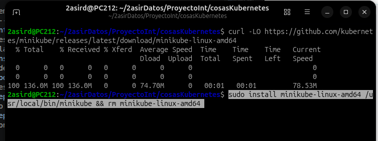

Comprobamos que se ha instalado correctamente consultando su versión:

```bash
minikube version
```

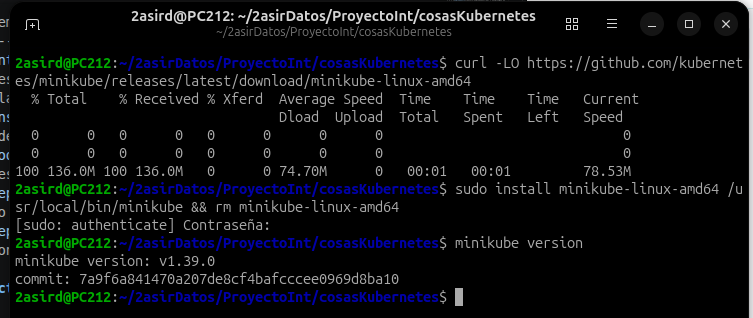

## 2.2. Arranque del clúster

```bash
minikube start
```

Minikube detecta automáticamente el controlador (*driver*) disponible, en este caso **Docker**, descarga la imagen base y la versión de Kubernetes (v1.37.0) y levanta el nodo del plano de control. Al terminar, deja `kubectl` configurado para usar el clúster `minikube`.

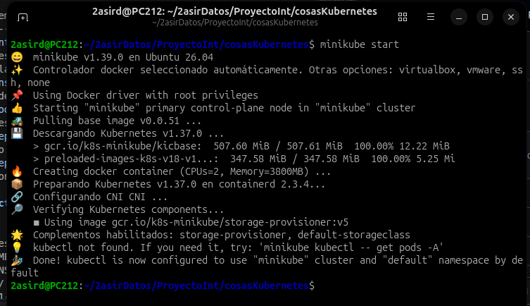

> En este punto todavía no está instalado `kubectl`, por eso aparece el aviso *"kubectl not found"*. Se instala en el apartado 2.4.

### Comprobaciones

Estado de los componentes del clúster (todos deben estar en `Running` y `kubeconfig` en `Configured`):

```bash
minikube status
```

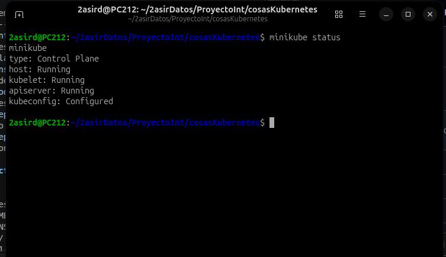

Datos del perfil: driver, runtime de contenedores, IP del nodo, versión de Kubernetes y estado:

```bash
minikube profile list
```

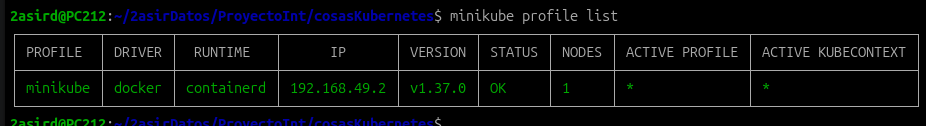

Como el driver es Docker, el nodo de Minikube es en realidad un **contenedor**. Se puede ver con:

```bash
docker ps
```

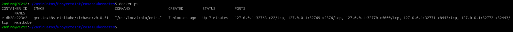

## 2.3. Usar otro driver (VirtualBox)

Si se quiere usar otro controlador en lugar del que se elige automáticamente, se indica al arrancar:

```bash
minikube start --driver=virtualbox
```

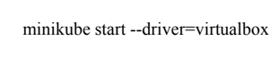

Para cambiar de driver hay que eliminar antes el clúster existente. Se para, se borran todos los perfiles y se elimina el directorio oculto de configuración:

```bash
minikube stop
minikube delete --all
rm -rf ~/.kube
```

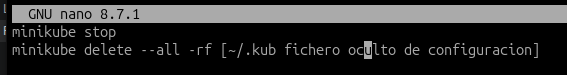

## 2.4. Instalación de kubectl

Se descarga la última versión estable y se instala en `/usr/local/bin` con propietario `root` y permisos `0755`:

```bash
curl -LO "https://dl.k8s.io/release/$(curl -L -s https://dl.k8s.io/release/stable.txt)/bin/linux/amd64/kubectl"
sudo install -o root -g root -m 0755 kubectl /usr/local/bin/kubectl
```

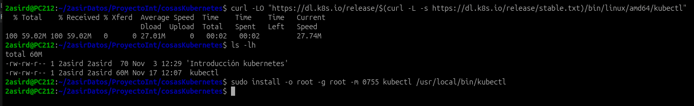

### Comprobaciones

Versión del cliente (`kubectl`) y del servidor (el clúster de Minikube):

```bash
kubectl version
```

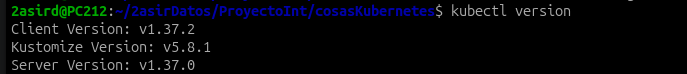

Nodos del clúster con información ampliada. Debe aparecer el nodo `minikube` en estado `Ready` con el rol `control-plane`:

```bash
kubectl get nodes -o wide
```

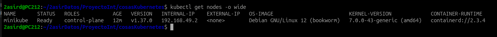

## 2.5. Autocompletado de comandos

Primero se instala el paquete `bash-completion` (en este caso ya venía instalado):

```bash
sudo apt update
sudo apt install -y bash-completion
```

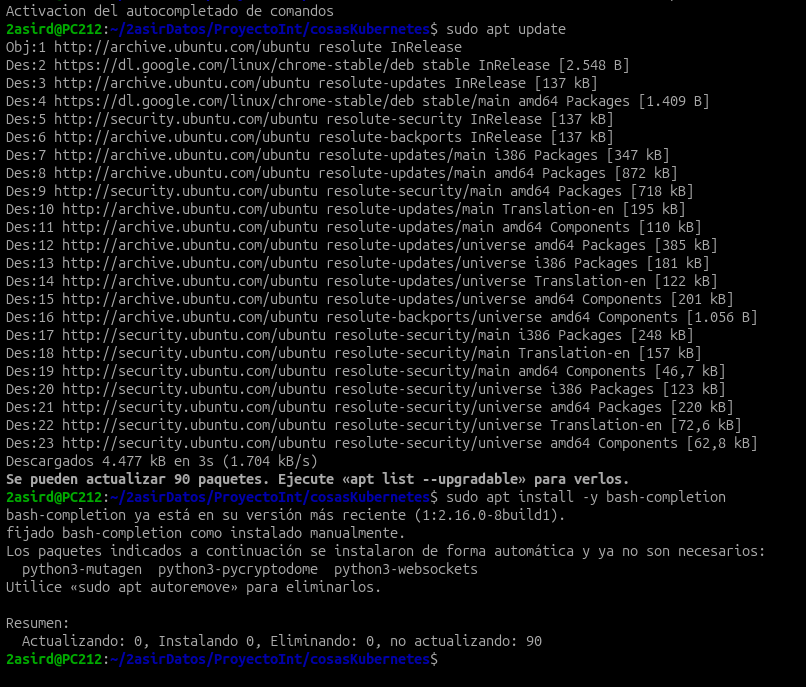

Después se añade al `~/.bashrc` el autocompletado de cada herramienta, para que se cargue en cada terminal nueva.

**kubectl:**

```bash
echo 'source <(kubectl completion bash)' >> ~/.bashrc
```

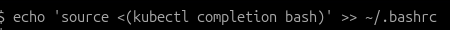

**Minikube:**

```bash
echo 'source <(minikube completion bash)' >> ~/.bashrc
```

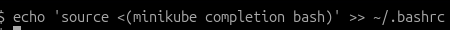

Para aplicarlo en la terminal actual sin abrir una nueva:

```bash
source ~/.bashrc
```

## 2.6. Anotación: instalación de Docker

En este entorno Docker ya venía instalado, pero si hay que instalarlo, uno de los pasos básicos es añadir el usuario al grupo `docker` para poder usarlo sin `sudo`, y aplicar el cambio de grupo en la sesión actual con `newgrp`:

```bash
sudo usermod -aG docker $USER
newgrp docker
```

En Ubuntu el comando `newgrp` puede no estar disponible de serie; viene en el paquete `util-linux-extra`, que conviene instalar antes:

```bash
sudo apt install util-linux-extra -y
```

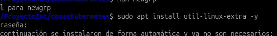

---

⬅️ [1. Introducción](1-Introduccion.md) · [Índice](../README.md) · [3. Pods](3-PODS.md) ➡️
